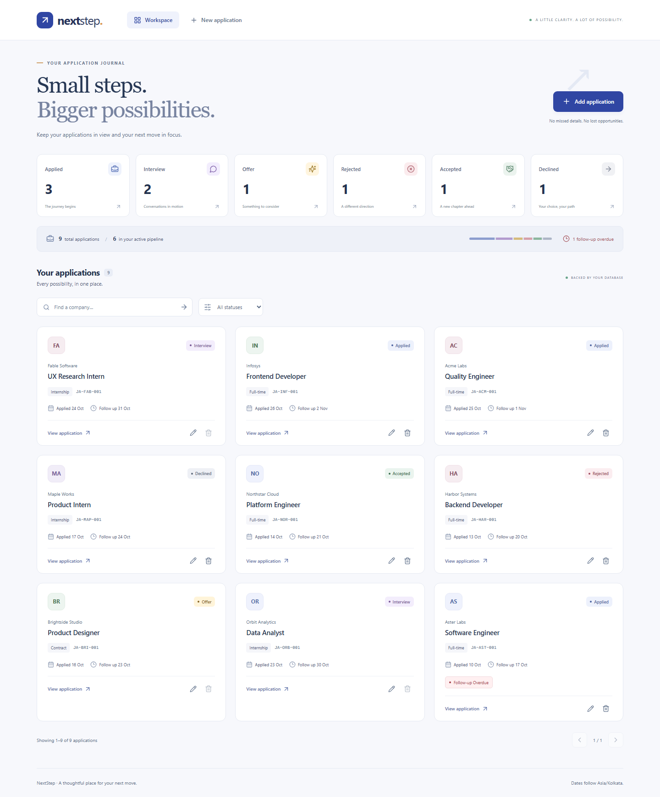
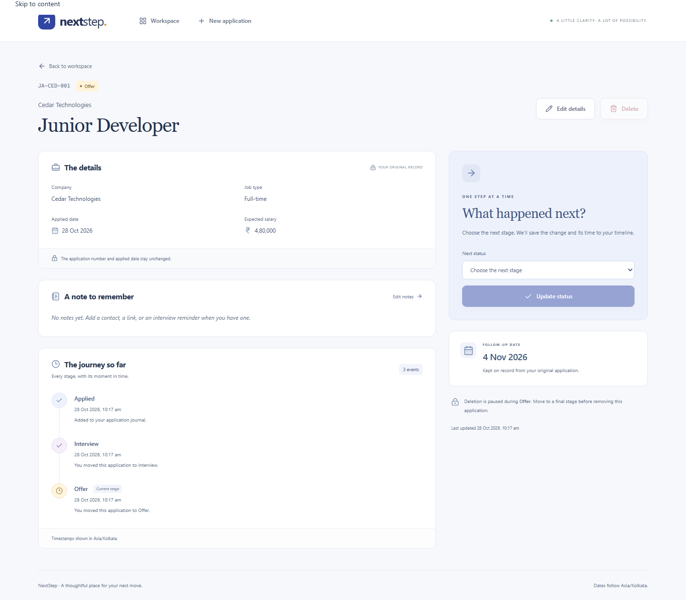

# NextStep — Job Application Journal

A focused MERN application for recording applications, following each decision, and noticing when a follow-up is due.

**Assessment repository:** https://github.com/johanisdone/mernfinal

## Project scope

- Add an application with company, role, job type, applied date, optional salary, and notes.
- Server-generated company-specific application numbers, immutable after creation.
- Strict Applied → Interview/Rejected → Offer/Rejected → Accepted/Declined workflow.
- Server-maintained status timeline and follow-up date.
- Backend company search, status filtering, pagination, and per-status counts.
- Prefilled editing, active-duplicate prevention, and status-dependent deletion.
- Responsive dashboard, application detail, and form screens.

The required workflow is implemented. **Database status:** verified against the dedicated MongoDB Atlas exam database. The real frontend/backend/Atlas journey passed five scenarios, in addition to 14 isolated API/database scenarios and 10 browser scenarios. No production credentials are reused.

## Repository layout

```text
frontend/   React, Vite, routing, API service, responsive UI
backend/    Express API, Mongoose models, rules, controllers, validation
docs/       design notes, verification evidence, screenshots
scripts/    end-to-end browser verification
```

## Local setup

```sh
git clone https://github.com/johanisdone/mernfinal.git
cd mernfinal
npm install
npm run dev
```

`backend/.env` already contains the provided **exam-only** MongoDB Atlas URI pointing to `mernfinal_exam`. Allow the development/evaluation machine's IP in Atlas Network Access before starting. Frontend: http://localhost:5174; API: http://localhost:5001.

`npm run build` produces the frontend bundle; `npm start` serves the built UI and API together at http://localhost:5001. No additional frontend installation is required: root npm workspaces install both dependency sets. All application operations go through the Express API to MongoDB; the frontend does not use localStorage or an in-memory data fallback.

The `.env` files are tracked because the assessment explicitly requires them. They contain the intentionally shared exam-only connection supplied for evaluation, not a personal/production account. The Atlas user must retain readWrite access to `mernfinal_exam` only. The supplied connection passed the real Atlas/browser verification. Atlas Network Access must also allow the evaluator's machine or the exam's required evaluation network; database credentials alone do not bypass that separate access list.

| File / variable | Purpose |
| --- | --- |
| `backend/.env` → `MONGODB_URI` | Exam-only Atlas connection, database `mernfinal_exam` |
| `PORT` | API and production UI port, default `5001` |
| `FRONTEND_ORIGIN` | Development browser origin, `http://localhost:5174` |
| `APP_TIMEZONE` | Calendar for today/overdue checks, `Asia/Kolkata` |
| `NODE_ENV` | Development or production |
| `frontend/.env` → `VITE_API_BASE` | Public API base `/api`; Vite proxies it in development |

Atlas setup: create a database user with **readWrite on `mernfinal_exam` only**, copy its driver URI, encode password characters if needed, and include `/mernfinal_exam` before any query parameters. Use a dedicated temporary account that evaluators can access. Rotate/remove the public exam credential after evaluation. Atlas network access is configured separately from the user's database permissions.

## API list

Every response uses `{ success, message, data }`, including errors. List results use `data.items` and `data.pagination`; failed field validation uses `data.errors`.

| Method | Endpoint | Purpose |
| --- | --- | --- |
| GET | `/api/health` | Database readiness: 200 connected / 503 unavailable |
| GET | `/api/applications/options` | Job types, statuses, server calendar date and timezone |
| POST | `/api/applications` | Add an application; returns 201 with generated identity/history |
| GET | `/api/applications` | List applications; supports `company`, `status`, `page`, `limit` |
| GET | `/api/applications/stats` | Overall counts for all six statuses, total and overdue count |
| GET | `/api/applications/:id` | Read an application, status history, and allowed next statuses |
| PATCH | `/api/applications/:id` | Edit company, role, job type, salary, and/or notes |
| PATCH | `/api/applications/:id/status` | Perform one valid workflow transition |
| DELETE | `/api/applications/:id` | Delete only Applied, Rejected, Accepted, or Declined |

List example: `/api/applications?company=infosys&status=Applied&page=1&limit=9`. Search is case-insensitive and treats regex characters literally. Counts remain global while the list is filtered. Page size is bounded to 50.

Creation body:

```json
{
  "companyName": "Infosys",
  "jobRole": "Frontend Developer",
  "jobType": "Full-time",
  "appliedDate": "2026-10-28",
  "expectedSalary": 600000,
  "notes": "Applied through the company careers page."
}
```

Optional salary can be omitted/null; notes can be omitted. Job Type is `Full-time`, `Internship`, or `Contract`. Do not send `applicationId`, status, history, or follow-up date in a creation body. Date must be today or earlier. Editing the applied date or issued ID is rejected, not silently ignored. Status update body: `{ "status": "Interview" }`.

Normal reads/updates/deletes return 200. Invalid input, transitions, or disallowed deletion return 400; missing applications return 404; duplicate active applications, concurrent changes, and sequence exhaustion return 409. Unexpected failures return a safe 500 envelope.

## Workflow and business rules

```text
Applied ──> Interview ──> Offer ──> Accepted (final)
   │            │           └───> Declined (final)
   └────────────┴───────────────> Rejected (from Applied/Interview only)
```

- The backend alone generates `JA-<3 company letters>-<001..999>` using an atomic per-company counter.
- Company names must contain three alphabetic letters. ID prefix is based on the original company name; company edits never reissue the ID.
- Shared prefixes are collision-checked with a unique index. Sequences increase but may have gaps. See the design note for the capacity limit.
- Company/role comparison ignores capitalization and repeated spaces. An active-only compound unique index enforces the duplicate rule during creates and edits, including races.
- Every new application begins at Applied. Only allowed transitions are offered by the frontend and accepted by the backend. All final statuses are locked.
- Status history includes the initial Applied event and server timestamps for successful changes.
- Applied and follow-up dates are date-only ISO values. The backend adds seven calendar days; overdue means **Applied and today strictly later than Follow-up Date**.
- Salary is non-negative, optional, in INR, with at most two decimal places. Notes are plain text.
- Delete is disabled during Interview/Offer and rejected by the API; permitted deletions require confirmation in the UI.
- Conditional writes protect against stale edits and status/deletion races.

## Verification

```sh
npm test
npm run build
npx playwright install chromium
npm run test:ui
```

Verified locally: **14 API/database scenarios and 10 browser scenarios**. The browser suite captures desktop/mobile views and checks selected WCAG A/AA rules with axe, including horizontal overflow at 390px. This is not a complete accessibility certification. Test fixtures are fictional.

Tests use a separate isolated MongoDB 8.2.6 process and download its binary on a clean machine. They do not use or reset the Atlas exam database. Evidence: [API record](docs/evidence/api.json), [browser record](docs/evidence/browser.json), and [verification notes](docs/VERIFICATION.md).

To repeat the real Atlas verification, run:

```sh
npm run build
npm run verify:atlas
```

This opens the real built frontend against Atlas and checks creation, editing, duplicate messages, status history, deletion protection, and final deletion. It creates one uniquely named verification application and cleans up only that fixture and its company counter. Successful results are recorded in [Atlas verification evidence](docs/evidence/atlas.json) without credentials. **The five Atlas scenarios passed.**

## Screenshots of the working application

Actual captures from the integrated frontend, API, and isolated test database. These are not static mockups or proof of Atlas connectivity.

### Workspace — counts, filters, status cards, and overdue cue



### Application details — persisted timeline and guarded next-stage controls



Additional [mobile workspace](docs/screenshots/04-workspace-mobile.png), [mobile timeline](docs/screenshots/05-details-mobile.png), [mobile edit form](docs/screenshots/06-edit-mobile.png), and [desktop entry form](docs/screenshots/02-application-form.png).

## Submission readiness

- Frontend/backend structure, package files, tracked exam `.env` files, API list, screenshots, and at least five implementation milestones are present.
- Business rules and integrated UI are verified locally, and the real frontend-to-Atlas workflow is verified separately.
- Fresh evaluators need Node.js 22.12+, `npm install`, and an Atlas-permitted network connection before `npm run dev`.
- GitHub repository: https://github.com/johanisdone/mernfinal
- No hosted link is required by this assessment; the repository and reproducible Atlas-connected app are the submission.

## Design and originality

This implementation is written for the assessment requirements, with its own application flow, business-rule modules, interface, and explanatory documentation. Framework conventions and third-party dependencies retain their standard APIs; a similarity percentage cannot be guaranteed or claimed without a checker report. Official references: [React](https://react.dev/), [Express](https://expressjs.com/), [Mongoose](https://mongoosejs.com/), and [MongoDB Atlas](https://www.mongodb.com/docs/atlas/).

See [design decisions](docs/DESIGN.md) for date handling, counter allocation, duplicate indexes, and mutation rules. Standard library/framework interfaces are used as documented; source references are acknowledged rather than disguising their provenance.
